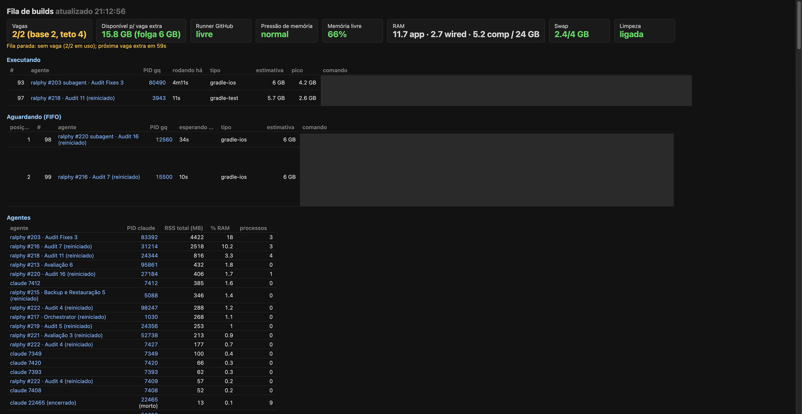
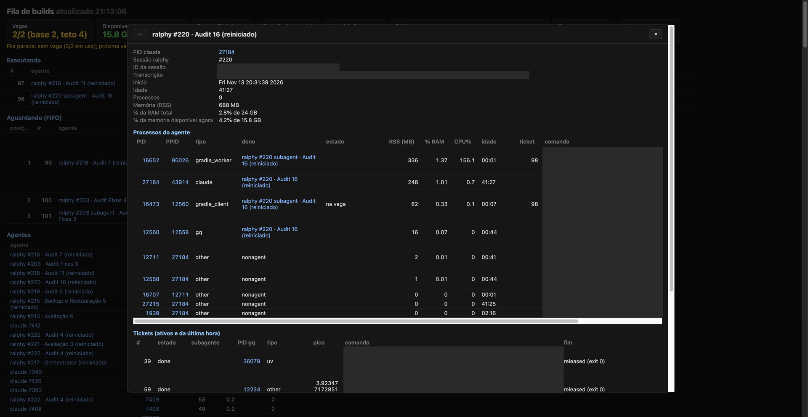

# build-queue

**English** · [Português](README.pt-BR.md)

Machine-wide FIFO queue for the Gradle/JVM runs of the Claude agents, with a memory monitor, process cleanup
and a page at http://127.0.0.1:8787. Runs on macOS, Linux and Windows.





The page speaks English (EN-US) and Portuguese (PT-BR): it starts in the browser language and keeps the choice
made in its selector. The screenshots show it in Portuguese, with command lines and session ids masked.

## Rules

- **2 slots**, counting the GitHub self-hosted runner (a live `Runner.Worker` = 1 slot). The runner never
  waits: if it arrives with 2 local builds running, the count goes to 3 until one ends, and nobody new gets in.
- **Strict FIFO**: only the head of the queue may start.
- **Dynamic limit, from 2 slots up to a ceiling set by the machine's RAM**: RAM / 6 GB, rounded up
  (16 GB → 3, 24 GB → 4, 32 GB → 6, 48 GB → 8; never below 2). With every slot taken, the limit rises by 1 slot for the head of the queue
  only if: memory pressure is not critical, 30 s have passed since the last raise, and the system's available memory minus
  the item's estimate leaves ≥ 6 GB of headroom. Each run that ends lowers the limit by 1 (never below 2);
  the next raise goes through the same analysis. A raise always adds exactly 1 slot: when runs that never
  wait (runner, builds outside an agent) already hold it, nobody enters until the next raise.
- **Estimate per command type** (`gradle-check`, `gradle-backend`, `gradle-ios`, `gradle-test`,
  `gradle-lint`, `gradle`, `xcodebuild`, `java`, `pod`, `uv`): the largest peak of the last 5 released runs
  of the same type; before that, the `DEFAULT_GB` table in `bq/core.py`. The peak adds up the `gq` tree, the
  Gradle daemon serving the client, its workers and the Kotlin daemon attached to it.
- **Memory**: only critical pressure blocks (nobody enters, extra slot included). macOS: the kernel's `critical`
  level (`warn` does not block). Linux: PSI `full avg10` ≥ 10% in `/proc/pressure/memory`. Windows: the
  kernel's low-memory notice (`LowMemoryResourceNotification`). Without that signal: under 5% of RAM available.
- These count as a run: `./gradlew`, `xcodebuild`, `pod install`, direct `java`/`kotlinc`, `uv run`.
- Builds outside an agent (your terminal, Android Studio) take a slot, but are never killed.
- Never touched: the runner (`GITHUB_ACTIONS`, `~/.gradle-health-hub-ci`), the staging backend
  (`~/.health-hub-local`), `claude` processes, the server itself.

## Use by the agents

```
cd ../worktree && gq run -- ./gradlew :shared:check      # Bash with run_in_background: true
gq status
```

`gq` takes a ticket, waits for a slot without spending tokens, runs the command and frees the slot on exit
(crashes included: the server reaps the ticket when the `gq` PID dies). `gq` inside a `gq` reuses the slot.

The global `PreToolUse` hook (`bq/hook.py`) denies every Bash call that runs these commands outside
`gq run`, and every `gq run` without `run_in_background`.

## Cleanup (`gq enforce on|off`)

In `off` (dry run) the page only lists what it would kill. In `on`:

- agent build without a slot: SIGTERM on the tree, SIGKILL after 10 s (Windows has no graceful stop: it dies
  at once);
- agent process whose `claude` session has already died;
- agent Gradle daemon idle for 20 s (no client connected) and no grant in the last 20 s;
- agent Kotlin daemon idle for 60 s, even with builds running (KGP falls back to the compiler inside Gradle);
- Gradle worker whose parent daemon died (its parent is no longer a Gradle process: init, a Linux subreaper,
  or a reused Windows pid).

The owner of each process comes from the `CLAUDE_PID`, `CLAUDE_CODE_SESSION_ID` and `RALPHY_STATUS_FILE`
variables, which every process an agent creates inherits, detached daemons included.

## Installation

Needs Python 3.10+. The server runs in a venv with [psutil](https://github.com/giampaolo/psutil), which reads
processes, environment, connections and memory on all three systems; `gq` and the hook use only the standard
library.

| System | Install | `com.massa.build-queue` service | Log |
|---|---|---|---|
| macOS | `./install.sh` | launchd agent | `~/Library/Logs/build-queue.log` |
| Linux | `./install.sh` | `systemctl --user` | `journalctl --user -u com.massa.build-queue` |
| Windows | `powershell -ExecutionPolicy Bypass -File install.ps1` | Task Scheduler task, at logon | `~/.local/share/build-queue/server.log` |

On Linux the user service stops at logout; to keep it running: `loginctl enable-linger $USER`.
On Windows the installer puts `gq` (for Git Bash, where Claude Code runs Bash) and `gq.cmd` in `~/.local/bin`;
that folder must be on PATH.

Tests, the same ones GitHub Actions runs on macOS, Linux and Windows (on Windows the venv Python is
`Scripts\python.exe`):

```
~/.local/share/build-queue/venv/bin/python -m unittest discover -s tests -p "test_*.py"
~/.local/share/build-queue/venv/bin/python tests/live_check.py   # real queue, isolated on port 8788
```

Hook in `~/.claude/settings.json`, `hooks.PreToolUse`:

```json
{"matcher": "Bash", "hooks": [{"type": "command",
  "command": "python3 $HOME/Projects/claude-build-queue/bq/hook.py"}]}
```

On Windows, `python` instead of `python3`. State: `~/.local/share/build-queue/` (`queue.db`, `config.json`).
