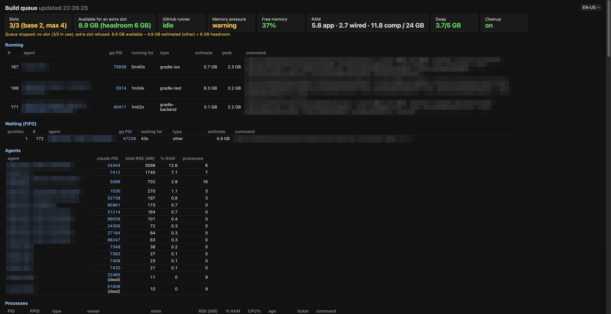
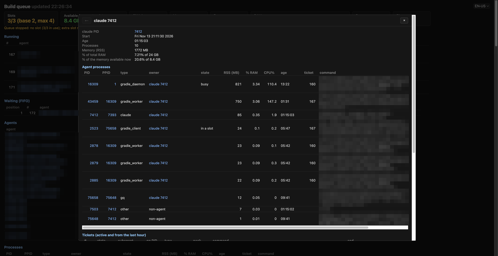

# Claude Build Queue

**English** · [Português](README.pt-BR.md)

Machine-wide FIFO queue for the heavy builds of the Claude agents (Gradle/JVM, Xcode, Node/JS, C/C++, .NET,
Swift, Rust, Go, Maven, sbt), with a memory monitor, process cleanup and a page at http://127.0.0.1:8787.
Runs on macOS, Linux and Windows.





The page speaks English (EN-US) and Portuguese (PT-BR): it starts in the browser language and keeps the choice
made in its selector. Command lines and agent names are masked in these screenshots.

## Rules

The numbers below are the defaults; every one of them is a setting (see [Settings](#settings)).

- **2 slots**, counting the GitHub self-hosted runner (a live `Runner.Worker` = 1 slot). The runner never
  waits: if it arrives with 2 local builds running, the count goes to 3 until one ends, and nobody new gets in.
- **Strict FIFO**: only the head of the queue may start.
- **No fixed ceiling**: the first 2 slots enter freely. Every build above them enters one at a time, and
  only if: memory pressure is not critical; swap did not grow by 0.5 GB or more in the last 60 s; 30 s have
  passed since the last extra entry; and the system's available memory, minus the peak reserve of the running
  builds, minus the item's estimate, leaves ≥ 6 GB of headroom. A running build's peak reserve is its
  estimate minus its current memory (never below 0): a build that just started still counts the memory it is
  about to take. A build that ran before (same repo, worktrees together, and same build: the build commands it runs,
  without wrappers such as `perl -e 'alarm N; exec @ARGV'`, `timeout` or `env`, quiet flags or redirections; a
  shell script counts as the builds written in it plus its arguments; with no run of that build, the last runs
  of the same repo and command type) reserves,
  instead of its estimate, the mean of the most memory each of its last 3 runs still used from that second on,
  minus its current memory: once past the last peak, the reserve drops and the queue moves. A run already over
  at that second counts 0. Tickets that exit 0 and builds without a ticket keep their curve, when measured from
  their start. Queued builds, the runner (by the `gradle-check` estimate) and builds without a ticket (agent
  builds without a slot, builds outside an agent, by their command type) all reserve. When a signal turns bad,
  nothing is killed: extra entries stop until it clears. `gq config max N` caps the slots at N (at least the base slots);
  `gq config max off`, the default, removes the cap.
- **Estimate per command type** (`gradle-check`, `gradle-backend`, `gradle-ios`, `gradle-test`,
  `gradle-lint`, `gradle`, `xcodebuild`, `java`, `pod`, `uv`, `node`, `cc`, `bazel`, `dotnet`, `msbuild`,
  `swift`, `cargo`, `go`, `maven`, `sbt`): the largest peak of the last 5 released runs
  of the same type; before that, the starting estimate of the type, in the settings. The peak adds up the `gq` tree, the
  Gradle daemon serving the client, its workers and the Kotlin daemon attached to it.
- **Memory**: only critical pressure blocks (nobody enters, extra slot included). macOS: the kernel's `critical`
  level (`warn` does not block). Linux: PSI `full avg10` ≥ 10% in `/proc/pressure/memory`. Windows: the
  kernel's low-memory notice (`LowMemoryResourceNotification`). Without that signal: under 5% of RAM available.
- These count as a run: `./gradlew`, `xcodebuild`, `pod install`, direct `java`/`kotlinc`, `uv run`.
- These also go through the queue (the hook demands `gq run`), with their own command type:
  - Node/JS: `npm`/`pnpm`/`yarn`/`bun` install, test and scripts named like build/test/compile/typecheck/e2e
    (not dev/watch/serve/start), `npx`/`exec`/`dlx` of the tools below, `tsc`, `next build`, `vite build`,
    `jest`, `vitest` (not in watch mode), `nx`/`turbo` build/test tasks, `webpack` (not `serve`/watch);
    `--filter`/`--workspace`/`--cwd` values are understood (`pnpm --filter web build`);
  - C/C++: `cmake --build`, `make`, `ninja`, `msbuild`, direct `clang`/`gcc`/`g++`/`cc` with an input file,
    `bazel build|test|coverage`;
  - .NET: `dotnet build|test|publish|restore|pack|msbuild`;
  - others: `swift build|test`, `cargo build|test|bench|check|clippy`, `go build|test|install`, `mvn`/`mvnw`, `sbt`.

  Version and help queries (`--version`, `--help`, `/version`) and cheap subcommands (`npm run dev`,
  `go vet`, `dotnet run`, `cmake -S . -B build`) stay outside.
- A build without a slot is never killed, Gradle included: the hook is the only enforcement. It still takes a
  slot, so the queue waits for it.
- Builds outside an agent (your terminal, Android Studio) take a slot, but are never killed.
- Never touched: the runner (`GITHUB_ACTIONS`, or a command line containing a runner marker, `/actions-runner/`
  by default), a process whose command line contains a protected path (none by default; a local backend, for
  example), `claude` processes, the server itself.

## Settings

The ⚙ button on the page opens the settings. The simple part has the base slots, the cap, a memory profile
(Careful, Balanced, Bold: headroom, swap limit and gap between extra builds together), the cleanup and the start
with the system. **Advanced** has every setting, each with its default: queue and memory thresholds, cleanup
timers, protected paths and runner markers (one per line), the starting estimate of each command type, the port
and the scan interval.

**Save & Apply** validates every value (nothing is saved while one is wrong), writes `config.json` and restarts
the server; running builds keep running and `gq` reconnects. A new port moves the page to it; `gq` and the hook
read the port from `config.json` too, but a `gq` already running keeps the old one, so change it with no build
waiting. `BQ_PORT` in the server's environment wins over the setting. The start with the system is the service
manager's own switch (launchd, `systemctl --user`, the logon trigger of the Windows task); reinstalling turns it
back on. The page accepts these changes only from itself: a JSON request whose `Host` and `Origin` are
`127.0.0.1` or `localhost` on the server's port.

## Use by the agents

```
cd ../worktree && gq run -- ./gradlew :shared:check      # Bash with run_in_background: true
gq status
gq config max 6        # optional cap on slots; off by default
```

`gq` takes a ticket, waits for a slot without spending tokens, runs the command and frees the slot on exit
(crashes included: the server reaps the ticket when the `gq` PID dies). `gq` inside a `gq` reuses the slot.

The global `PreToolUse` hook (`bq/hook.py`) denies every Bash call that runs these commands outside
`gq run`, and every `gq run` without `run_in_background`.

`gq status` prints the slots, memory, why the queue is stopped, and the open tickets; `(ended)` marks a ticket
whose agent has died. `gq`, the hook and the server log speak English; only the page is translated.

## Remote builds (`remote` in `config.json`)

Off by default. With a `remote` key, `gq run` sends an eligible Gradle command to another machine that runs this
same queue, instead of taking a local slot. That machine needs `gq` on the `PATH` of a non-interactive `ssh`
(`/usr/local/bin`, not `~/.local/bin`) with its server running, `rsync`, and whatever the build reads from
`local.properties` (the Android SDK through `ANDROID_HOME`, for example), because ignored files are not copied. Edit `config.json` by hand; the page does not show this key and keeps
it on Save & Apply.

```json
{"remote": {"host": "me@build-vm", "root": "~/remote-builds",
  "ssh_options": ["-i", "~/.ssh/google_compute_engine"],
  "instance": "build-vm", "zone": "us-central1-a", "project": "my-project"}}
```

- `host` (required): the `ssh` target. `root` (required): where the checkouts live there; `~/x` is relative to
  the remote home.
- `ssh_options` (optional): extra `ssh` arguments, also used by `rsync`.
- `instance`, `zone`, `project` (optional, all three or none): `gcloud compute instances start` before each
  remote run, so a stopped Compute Engine VM comes up; then `gq` waits up to 180 s for `ssh … true`.
- `local_tasks` (optional): a task containing one of these, case-insensitive, runs locally. Default:
  `ktlintFormat` (it rewrites the sources here), `ios`, `generateDummyFramework`, `installDebug`, `connected`.

Eligible: `./gradlew …` or `perl -e '<code>' ./gradlew …` (passed whole, so the `alarm` applies remotely), run
inside a git checkout, with no local task and no `-p`/`--project-dir` outside the checkout. Values of `-x`,
`--tests`, `-p`, `-I`, `-c` and `--console` are not tasks. Everything else (`xcodebuild`, `pod`, `uv`, `node`,
a script, a nested `gq`) stays local.

A remote run:

1. copies the checkout to `<root>/<main repository>/<worktree>` with `rsync --delete`, leaving out `/.git` and
   every file `.gitignore` ignores (`local.properties` included); the remote `build/`, `.gradle/` and
   `.kotlin/` survive, so the remote build stays incremental;
2. prints `[gq] remote <host>: <cmd>` and runs `ssh -tt <host> 'cd … && gq run -- <cmd>'`;
3. copies `build/reports/`, `build/test-results/` and `build/outputs/` of every project back, even when the
   build fails, and exits with the remote exit code.

If the VM does not start, `ssh` does not answer or the first copy fails, `gq` prints
`[gq] remote unavailable (<step>: <error>); running locally` and queues locally. Once the remote build has
started it never runs locally: a dropped connection exits 255 with `[gq] remote connection lost`. SIGTERM,
SIGINT, SIGHUP or SIGALRM on the local `gq` stop `ssh`; the pseudo-TTY makes the remote `gq` get SIGHUP and free
its slot. An invalid key prints `[gq] remote config ignored (<field>)` and changes nothing. Not on Windows (no
`flock`, no native `rsync`).

## Cleanup (`gq enforce on|off`)

In `off` (dry run) the page only lists what it would kill. In `on`:

- agent process whose `claude` session has already died: SIGTERM on the tree, SIGKILL after 10 s (Windows has
  no graceful stop: it dies at once);
- agent Gradle daemon idle for 20 s (no client connected) and no grant in the last 20 s;
- agent Kotlin daemon idle for 60 s, even with builds running (KGP falls back to the compiler inside Gradle);
- Gradle worker whose parent daemon died (its parent is no longer a Gradle process: init, a Linux subreaper,
  or a reused Windows pid);
- toolchain run (`npm`, `make`, `cargo`, ...) and build server whose agent died: MSBuild reuse nodes
  (`MSBuild.dll /nodemode:`), `VBCSCompiler`, the Razor server (`rzc.dll server`), the bazel server,
  `tsc --watch`, `eslint_d`. IDE language servers and caches (`tsserver`, `rust-analyzer`, `clangd`,
  `sourcekit-lsp`, `sccache`) are never touched;
- compiler (`clang`, `gcc`, `cc1plus`, `swift-frontend`, `rustc`) whose driver died (init or a subreaper
  adopted it). A compiler under a live parent (IDE, `pip install`) is left alone.

The owner of each process comes from the `CLAUDE_PID`, `CLAUDE_CODE_SESSION_ID` and `RALPHY_STATUS_FILE`
variables, which every process an agent creates inherits, detached daemons included.

## Installation

Needs Python 3.10+. The server runs in a venv with [psutil](https://github.com/giampaolo/psutil), which reads
processes, environment, connections and memory on all three systems; `gq` and the hook use only the standard
library.

| System | Install | `com.massa.build-queue` service | Log |
|---|---|---|---|
| macOS | `./install.sh` | launchd agent | `~/Library/Logs/build-queue.log` |
| Linux | `./install.sh` | `systemctl --user` | `journalctl --user -u com.massa.build-queue` |
| Windows | `powershell -ExecutionPolicy Bypass -File install.ps1` | Task Scheduler task, at logon | `~/.local/share/build-queue/server.log` |

On Linux the user service stops at logout; to keep it running: `loginctl enable-linger $USER`.
On Windows the installer puts `gq` (for Git Bash, where Claude Code runs Bash) and `gq.cmd` in `~/.local/bin`;
that folder must be on PATH.

Tests, the same ones GitHub Actions runs on macOS, Linux and Windows (on Windows the venv Python is
`Scripts\python.exe`):

```
~/.local/share/build-queue/venv/bin/python -m unittest discover -s tests -p "test_*.py"
~/.local/share/build-queue/venv/bin/python tests/live_check.py   # real queue, isolated on port 8788
```

Hook in `~/.claude/settings.json`, `hooks.PreToolUse`:

```json
{"matcher": "Bash", "hooks": [{"type": "command",
  "command": "python3 $HOME/Projects/claude-build-queue/bq/hook.py"}]}
```

On Windows, `python` instead of `python3`. State: `~/.local/share/build-queue/` (`queue.db`, `config.json`).
