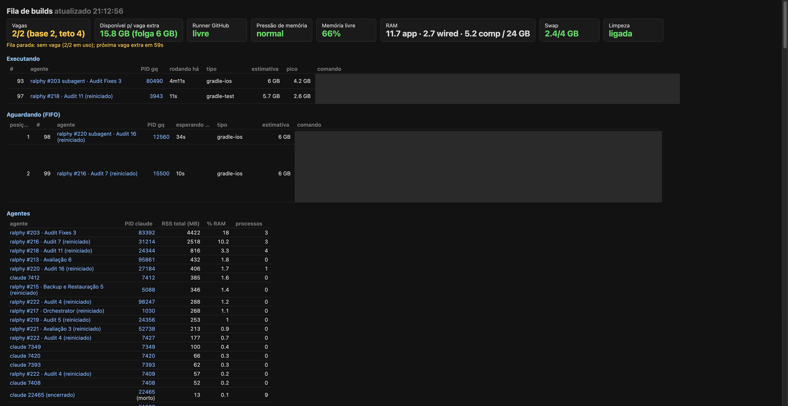
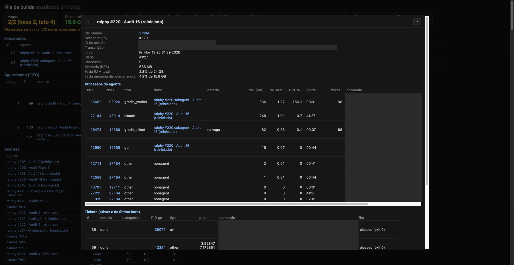

# Claude Build Queue

[English](README.md) · **Português**

Fila FIFO de máquina para os builds pesados dos agentes Claude (Gradle/JVM, Xcode, Node/JS, C/C++, .NET,
Swift, Rust, Go, Maven, sbt), com monitor de memória, limpeza de processos e página em http://127.0.0.1:8787.
Roda em macOS, Linux e Windows.





A página fala inglês (EN-US) e português (PT-BR): abre no idioma do navegador e guarda a escolha feita no
seletor. Linhas de comando e IDs de sessão estão mascarados nestes prints.

## Regras

Os números abaixo são os padrões; cada um deles é uma configuração (veja [Configurações](#configurações)).

- **2 vagas**, contando o runner self-hosted do GitHub (`Runner.Worker` vivo = 1 vaga). O runner nunca
  espera: se chega com 2 builds locais rodando, fica 3 até um terminar, e ninguém novo entra.
- **FIFO estrito**: só o primeiro da fila pode entrar.
- **Sem teto fixo**: as 2 primeiras vagas entram livres. Cada build acima delas entra um por vez, e só se:
  a pressão de memória não está crítica; o swap não cresceu 0,5 GB ou mais nos últimos 60 s; passaram 30 s
  desde a última entrada extra; e a memória disponível do sistema, menos a reserva de pico dos builds em
  execução, menos a estimativa do item, deixa ≥ 6 GB de folga. A reserva de pico de um build em execução é
  a estimativa dele menos a memória que ele usa agora (nunca abaixo de 0): um build recém-iniciado ainda
  conta a memória que vai tomar. Um build que já rodou antes (mesmo repo, worktrees juntas, e mesmo build: os
  comandos de build que ele roda, sem wrappers como `perl -e 'alarm N; exec @ARGV'`, `timeout` ou `env`, flags
  de silêncio ou redirecionamentos; um script shell vale pelos builds escritos nele mais os seus argumentos; sem
  execução desse build, as últimas do mesmo repo e tipo de comando) reserva, no lugar da estimativa, a média do maior consumo que cada uma das suas 3 últimas execuções
  ainda teve daquele segundo em diante, menos o atual: passado o último pico, a reserva cai e a fila anda. Uma
  execução que já tinha terminado naquele segundo conta 0. Guardam a curva os tickets que saem com exit 0 e
  os builds sem ticket, desde que medidos desde o início. Reservam os builds da fila, o runner (pela estimativa de `gradle-check`) e
  os builds sem ticket (build de agente sem vaga, build fora de agente, pelo tipo de comando). Quando um
  sinal piora, nada é morto: as entradas extras param até ele passar. `gq config max N` limita as vagas a N
  (no mínimo o número de vagas base); `gq config max off`, o padrão, tira o limite.
- **Estimativa por tipo de comando** (`gradle-check`, `gradle-backend`, `gradle-ios`, `gradle-test`,
  `gradle-lint`, `gradle`, `xcodebuild`, `java`, `pod`, `uv`, `node`, `cc`, `bazel`, `dotnet`, `msbuild`,
  `swift`, `cargo`, `go`, `maven`, `sbt`): maior pico das últimas 5 execuções liberadas
  do mesmo tipo; antes disso, a estimativa inicial do tipo, nas configurações. O pico soma a árvore do `gq`, o daemon
  Gradle que atende o cliente, os workers dele e o daemon Kotlin ligado a ele.
- **Memória**: só a pressão crítica bloqueia (ninguém entra, nem por vaga extra). macOS: nível `critical` do
  kernel (`warn` não bloqueia). Linux: PSI `full avg10` ≥ 10% em `/proc/pressure/memory`. Windows: o aviso de
  memória baixa do kernel (`LowMemoryResourceNotification`). Sem esse sinal: menos de 5% da RAM disponível.
- Contam como execução: `./gradlew`, `xcodebuild`, `pod install`, `java`/`kotlinc` direto, `uv run`.
- Também passam pela fila (o gancho exige `gq run`), cada um com seu tipo de comando:
  - Node/JS: `npm`/`pnpm`/`yarn`/`bun` install, test e scripts com nome de build/test/compile/typecheck/e2e
    (não dev/watch/serve/start), `npx`/`exec`/`dlx` das ferramentas abaixo, `tsc`, `next build`, `vite build`,
    `jest`, `vitest` (fora do modo watch), tarefas de build/test do `nx`/`turbo`, `webpack` (não `serve`/watch);
    valores de `--filter`/`--workspace`/`--cwd` são entendidos (`pnpm --filter web build`);
  - C/C++: `cmake --build`, `make`, `ninja`, `msbuild`, `clang`/`gcc`/`g++`/`cc` direto com arquivo de entrada,
    `bazel build|test|coverage`;
  - .NET: `dotnet build|test|publish|restore|pack|msbuild`;
  - outros: `swift build|test`, `cargo build|test|bench|check|clippy`, `go build|test|install`, `mvn`/`mvnw`, `sbt`.

  Consultas de versão e ajuda (`--version`, `--help`, `/version`) e subcomandos baratos (`npm run dev`,
  `go vet`, `dotnet run`, `cmake -S . -B build`) ficam fora.
- Build sem vaga nunca é morto, Gradle incluído: o gancho é a única imposição. Ele ainda ocupa vaga, então a
  fila espera por ele.
- Builds fora de agente (seu terminal, Android Studio) contam vaga, mas nunca são mortos.
- Nunca tocados: runner (`GITHUB_ACTIONS`, ou linha de comando com um marcador do runner, `/actions-runner/`
  por padrão), processo cuja linha de comando contém um caminho protegido (nenhum por padrão; um backend local,
  por exemplo), processos `claude`, o próprio servidor.

## Configurações

O botão ⚙ da página abre as configurações. A parte simples tem as vagas base, o teto, um perfil de memória
(Cuidadoso, Equilibrado, Ousado: folga, limite de swap e intervalo entre builds extras juntos), a limpeza e o
início com o sistema. **Avançado** tem todas as configurações, cada uma com seu padrão: limites da fila e da
memória, tempos da limpeza, caminhos protegidos e marcadores do runner (um por linha), a estimativa inicial de
cada tipo de comando, a porta e o intervalo de varredura.

**Salvar e aplicar** valida cada valor (nada é gravado enquanto um estiver errado), grava `config.json` e
reinicia o servidor; os builds em andamento continuam e o `gq` reconecta. Uma porta nova leva a página para ela;
o `gq` e o gancho também leem a porta do `config.json`, mas um `gq` já rodando continua na antiga, então mude
sem build esperando. `BQ_PORT` no ambiente do servidor vale no lugar da configuração. O início com o sistema é a
chave do próprio gerenciador de serviços (launchd, `systemctl --user`, o gatilho de logon da tarefa do Windows);
reinstalar liga de novo. A página só aceita essas mudanças vindas dela mesma: requisição JSON cujo `Host` e
`Origin` são `127.0.0.1` ou `localhost` na porta do servidor.

## Uso pelos agentes

```
cd ../worktree && gq run -- ./gradlew :shared:check      # Bash com run_in_background: true
gq status
gq config max 6        # teto opcional de vagas; desligado por padrão
```

`gq` pega um ticket, espera a vaga sem gastar token, roda o comando e libera a vaga ao sair (inclusive em
crash: o servidor recolhe o ticket quando o PID do `gq` morre). `gq` dentro de um `gq` reaproveita a vaga.

O gancho `PreToolUse` global (`bq/hook.py`) nega todo Bash que rode esses comandos fora de `gq run`,
e todo `gq run` sem `run_in_background`.

`gq status` mostra as vagas, a memória, por que a fila está parada e os tickets abertos; `(ended)` marca o
ticket cujo agente morreu. `gq`, o gancho e o log do servidor falam inglês; só a página é traduzida.

## Limpeza (`gq enforce on|off`)

Em `off` (simulação) a página só lista o que mataria. Em `on`:

- processo de agente cuja sessão `claude` já morreu: SIGTERM na árvore, SIGKILL após 10 s (o Windows não tem
  término gracioso: morre na hora);
- daemon Gradle de agente ocioso há 20 s (sem cliente conectado) e sem concessão nos últimos 20 s;
- daemon Kotlin de agente ocioso há 60 s, mesmo com builds rodando (o KGP cai no compilador dentro do Gradle);
- worker Gradle cujo daemon pai morreu (o pai deixou de ser um processo Gradle: init, subreaper do Linux ou
  PID reaproveitado no Windows);
- execução de toolchain (`npm`, `make`, `cargo`, ...) e servidor de build cujo agente morreu: nós reaproveitados
  do MSBuild (`MSBuild.dll /nodemode:`), `VBCSCompiler`, o servidor do Razor (`rzc.dll server`), o servidor do
  bazel, `tsc --watch`, `eslint_d`. Servidores de linguagem de IDE e caches (`tsserver`, `rust-analyzer`,
  `clangd`, `sourcekit-lsp`, `sccache`) nunca são tocados;
- compilador (`clang`, `gcc`, `cc1plus`, `swift-frontend`, `rustc`) cujo driver morreu (init ou um subreaper o
  adotou). Compilador com pai vivo (IDE, `pip install`) fica em paz.

O dono de cada processo vem das variáveis `CLAUDE_PID`, `CLAUDE_CODE_SESSION_ID` e `RALPHY_STATUS_FILE`,
que todo processo criado por um agente herda, inclusive daemons soltos.

## Instalação

Requer Python 3.10+. O servidor roda num venv com [psutil](https://github.com/giampaolo/psutil), que lê
processos, ambiente, conexões e memória nos três sistemas; `gq` e o gancho só usam a biblioteca padrão.

| Sistema | Instalar | Serviço `com.massa.build-queue` | Log |
|---|---|---|---|
| macOS | `./install.sh` | agente do launchd | `~/Library/Logs/build-queue.log` |
| Linux | `./install.sh` | `systemctl --user` | `journalctl --user -u com.massa.build-queue` |
| Windows | `powershell -ExecutionPolicy Bypass -File install.ps1` | tarefa do Agendador, no logon | `~/.local/share/build-queue/server.log` |

No Linux o serviço de usuário para no logout; para mantê-lo vivo: `loginctl enable-linger $USER`.
No Windows o instalador põe `gq` (para o Git Bash, onde o Claude Code roda o Bash) e `gq.cmd` em
`~/.local/bin`; essa pasta precisa estar no PATH.

Testes, os mesmos que o GitHub Actions roda em macOS, Linux e Windows (no Windows o Python do venv fica em
`Scripts\python.exe`):

```
~/.local/share/build-queue/venv/bin/python -m unittest discover -s tests -p "test_*.py"
~/.local/share/build-queue/venv/bin/python tests/live_check.py   # fila real isolada na porta 8788
```

Gancho em `~/.claude/settings.json`, `hooks.PreToolUse`:

```json
{"matcher": "Bash", "hooks": [{"type": "command",
  "command": "python3 $HOME/Projects/claude-build-queue/bq/hook.py"}]}
```

No Windows, `python` no lugar de `python3`. Estado: `~/.local/share/build-queue/` (`queue.db`, `config.json`).
